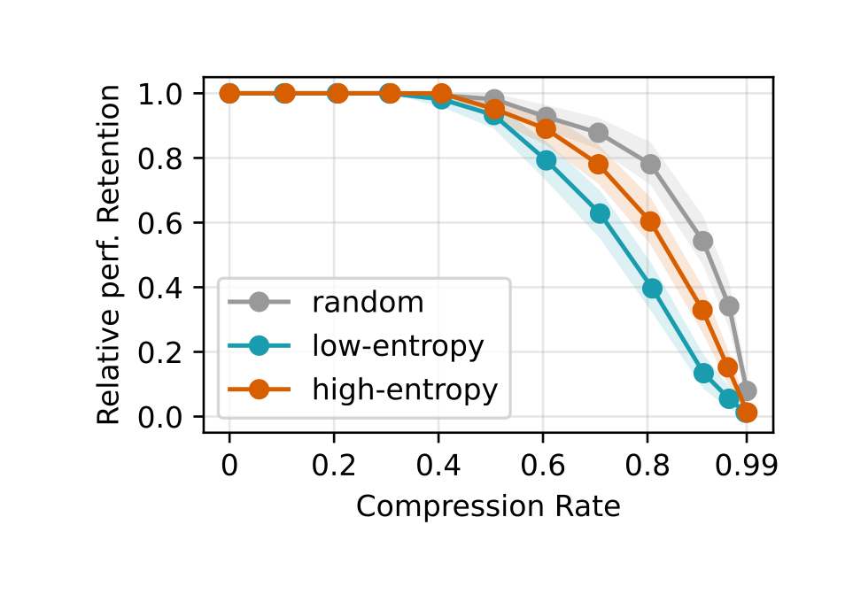

## Key findings

- **Entropy is no better than chance for sentences.** Across all models, model sizes and benchmarks, neither low- nor high-entropy sentence selection reliably outperforms random pruning.

- **The token-level advantage is about numbers, not entropy.** Low-entropy tokens look useful only on math tasks, because digits naturally have low entropy and carry the key content. Once numbers are removed, low-entropy selection falls below random.
- **Reasoning content is spread out.** With activation patching, keeping only about 9% of the trace (the numeric tokens) is enough to retain 90% of full-trace accuracy on AIME25. Without patching, the same tokens never get there.
