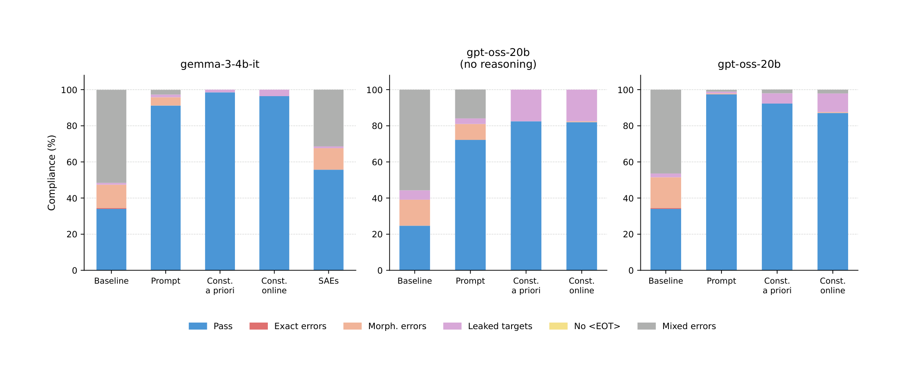
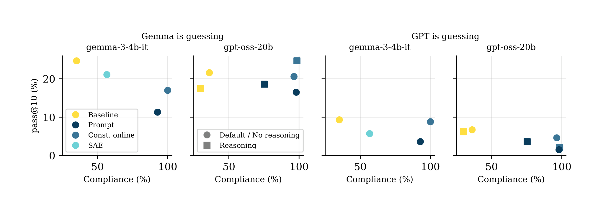

## Key findings

- **Explicit constraints work.** Without being told the forbidden words, models break the rules in about two thirds of cases. Prompting raises compliance above 90% for Gemma and for gpt-oss with reasoning, and constrained decoding reaches up to 98.5%.

- **Reasoning helps follow the rules.** gpt-oss-20b goes from 72% to 97% compliance under prompting when chain-of-thought is enabled.
- **How you constrain shapes what the model says.** Constrained decoding pushes models toward more precise paraphrases, and human guessers do best on these descriptions (38% vs. 23% for prompting). SAE steering keeps descriptions informative but often violates the rules and switches language.

- **Models are weak guessers.** Even the better judge needs 5 to 10 guesses to approach human first-try accuracy.
